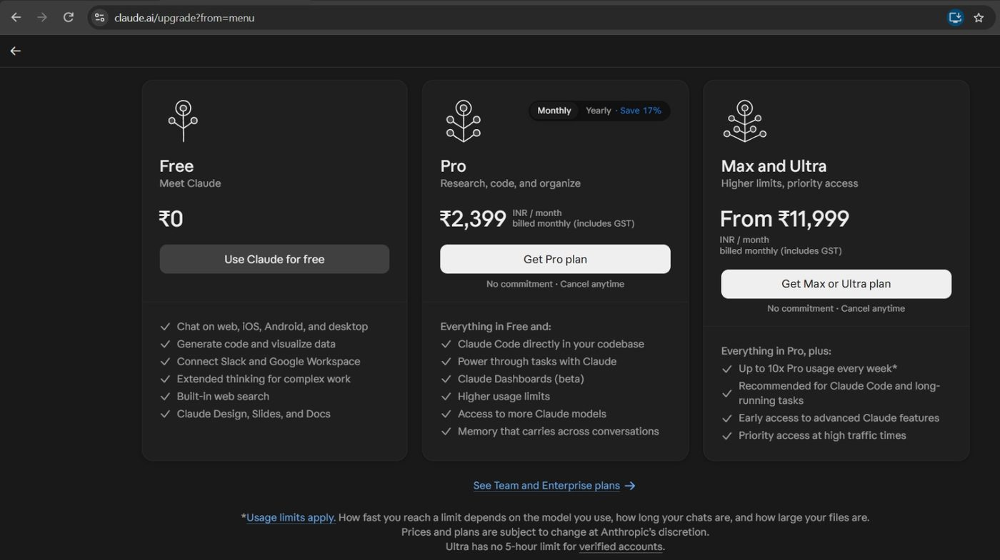
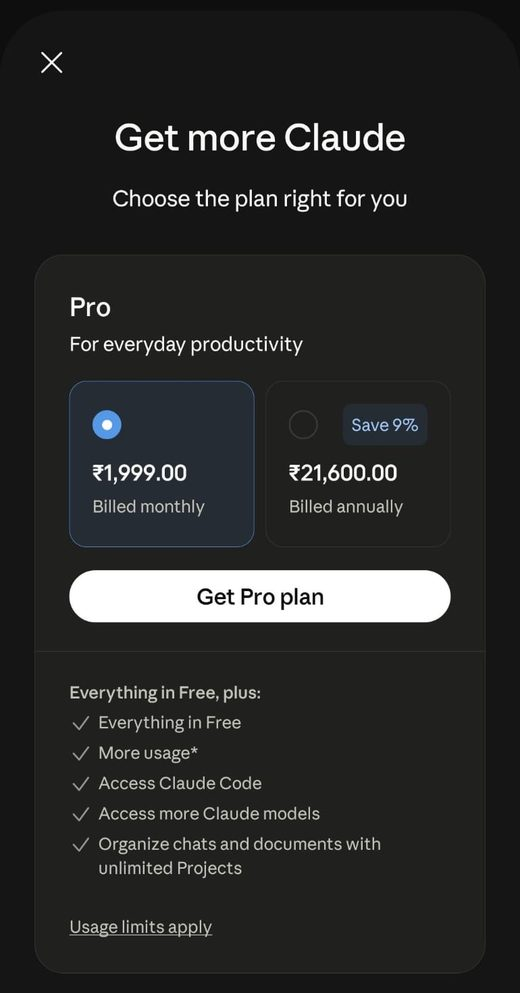
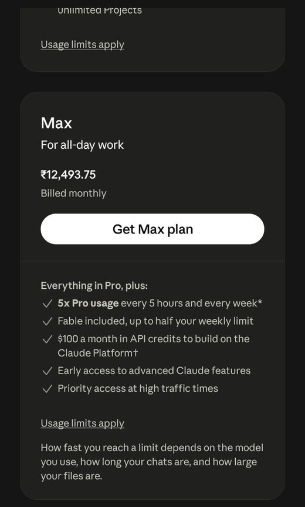
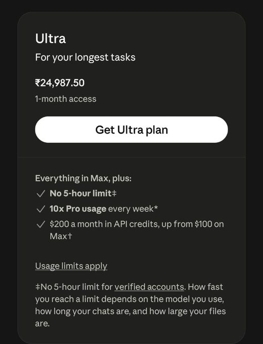
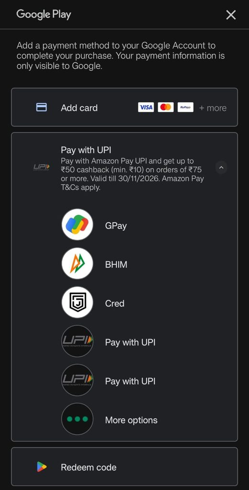

Claude Pro is cheaper in the Android app than on the website in India. When we checked, the app charged ₹1,999 a month for Pro and the website charged ₹2,399, a gap of ₹400 a month, or about 17%. For Max the website looked about 4% cheaper, and Ultra was listed only in the app at ₹24,987.50. This guide lays out every price we saw, what we could not confirm, and when the pay-as-you-go API is the better fit.

[[toc]]

## Claude prices in India at a glance

All prices are in Indian rupees, as shown on screen on the check date at the top of this page.

| Plan | Website (claude.ai) | Android app (Google Play) | Difference |
|---|---|---|---|
| Pro, monthly | ₹2,399, includes GST | ₹1,999.00 | App is ₹400 a month cheaper (about 17%) |
| Pro, yearly | ₹23,999 | ₹21,600.00 | App is ₹2,399 a year cheaper (about 10%) |
| Max, monthly | Max and Ultra shown together, from ₹11,999 | ₹12,493.75 | Website starts about ₹495 lower (about 4%) |
| Ultra | Shown together with Max | ₹24,987.50, "1-month access" | Not listed separately on the website |

The app saves real money on Pro. On Max the website looks slightly cheaper, but it lists Max and Ultra together under one "from" price, so the Max comparison is approximate.

## Claude Max and Ultra price in India

Max costs ₹12,493.75 a month in the Android app. The website lists Max and Ultra together, starting from ₹11,999 a month including GST, so the website is about ₹495 (4%) lower if that starting price is Max. Ultra costs ₹24,987.50 in the app, labelled "1-month access", and the website does not show a separate Ultra price. Max and Ultra suit heavy daily use, such as long coding sessions, and for most people Pro is the plan to compare first.

## What the website shows

The upgrade page at claude.ai lists Pro at ₹2,399 a month, billed monthly and including GST. Max and Ultra share one card that starts at ₹11,999 a month, also billed monthly and including GST. The page notes that prices and plans are subject to change at Anthropic's discretion.

## What the Android app shows

In the Android app, the same plans are priced through Google Play. Pro is ₹1,999.00 billed monthly, or ₹21,600.00 billed annually (the app labels this "Save 9%"). Max is ₹12,493.75 billed monthly, and Ultra is ₹24,987.50 with the label "1-month access", quoted here exactly as the app shows it.

## How the plans differ

The app lists what each tier adds. Pro gives more usage than Free, access to Claude Code and access to more Claude models. Max adds 5x Pro usage, includes the Fable model up to half your weekly limit, and lists $100 a month in API credits for the Claude Platform. Ultra adds 10x Pro usage every week, no 5-hour limit for verified accounts, and $200 a month in API credits. Usage limits apply on every plan, and how fast you reach them depends on the model, the length of your chats and the size of your files.

## How to pay in the app

Google Play offered cards and UPI (GPay, BHIM, Cred and others) when we looked. Payment offers change often, so read the terms of any cashback before relying on it.

## Does the same discount work on iPhone?

Yes. The in-app route works the same way on Apple's App Store. We show only the Android prices here, so check the price in your own app before you subscribe, because store prices can differ by platform.

## What we could not confirm: GST

The website price says it includes GST. The Google Play checkout and invoice we saw did not make clear whether the ₹1,999 price includes GST or how it is shown. We cannot confirm either way. If you need an invoice for GST input credit on a business purchase, the website, which states that GST is included, is the clearer route. Check with your accountant before you rely on either.

## Gift cards and region changes

Some online advice suggests store gift cards or changing your store region to pay less. We have not tested either and list no prices for them. Changing region can go against a store's terms and may cause problems with your account, so we do not recommend it.

## Pro or the API: which costs less?

Pro, Max and Ultra are flat monthly subscriptions for using Claude in the apps. The API is a separate product billed by the token, and it suits building your own tool or running a fixed workload. A subscription tends to win when you chat or code interactively most days. The API tends to win for a steady, predictable job you can measure. Here are the current Claude API prices, which update automatically.

[[api-prices Anthropic]]

To judge the API for your own workload, count your tokens with the [Token Counter](tool:token-counter), then estimate the monthly bill with the [Cost Forecaster](tool:cost-forecaster). You can compare Claude with other providers on [Model Prices](tool:model-prices).

## Frequently asked questions

### Is Claude Pro cheaper in the app in India?

On the check date, yes: ₹1,999 a month in the Android app against ₹2,399 on the website. The yearly plan is also cheaper in the app, at ₹21,600 against ₹23,999.

### How much do Claude Max and Ultra cost in India?

In the Android app, Max is ₹12,493.75 a month and Ultra is ₹24,987.50 ("1-month access"). The website starts at ₹11,999 for Max and Ultra together, so it looks about 4% cheaper for Max, but it does not list them separately, so treat that as approximate.

### Does the app price include GST?

We could not confirm it. The website says its price includes GST. The Google Play checkout and invoice did not make this clear.

### Do prices change?

Yes. Anthropic says prices and plans are subject to change. The date at the top of this page shows when we last checked the subscription prices, and the API table above refreshes automatically.
